<div align="center">


# PanelSummary

**Turn a book PDF into a manga that you read in your browser.**

<a href="https://github.com/Legend101Zz/PanelSummary/releases/tag/v0.3.0"></a>
<a href="https://github.com/Legend101Zz/PanelSummary/actions/workflows/ci.yml"></a>
<a href="LICENSE.md"></a>
<a href="#how-it-works"></a>
<br>


[Why](#why-panelsummary) · [Features](#features) · [Examples](#examples) · [The app](#the-app) ·
[How it works](#how-it-works) · [Quality](#quality) · [Quick start](#quick-start) · [Roadmap](#roadmap) · [License](#license)

| *The Happy Prince*, Oscar Wilde | *Self-Reliance*, Ralph Waldo Emerson | *Just So Stories*, Rudyard Kipling |
|---|---|---|
| 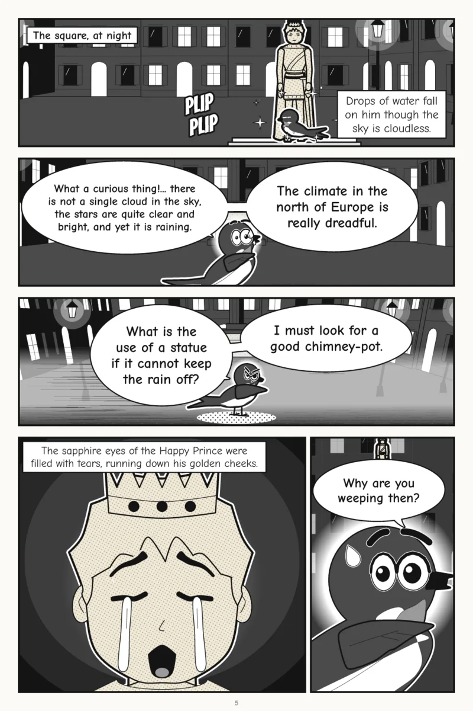 | 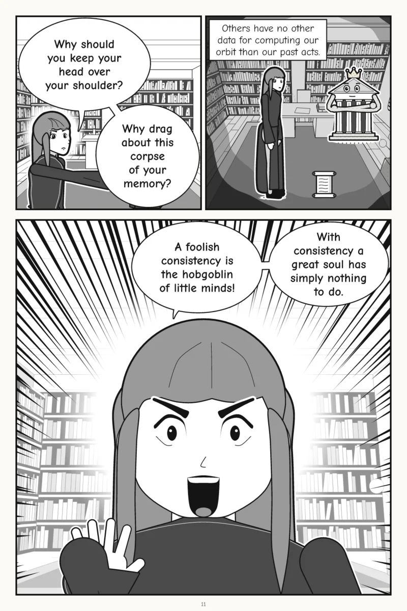 | 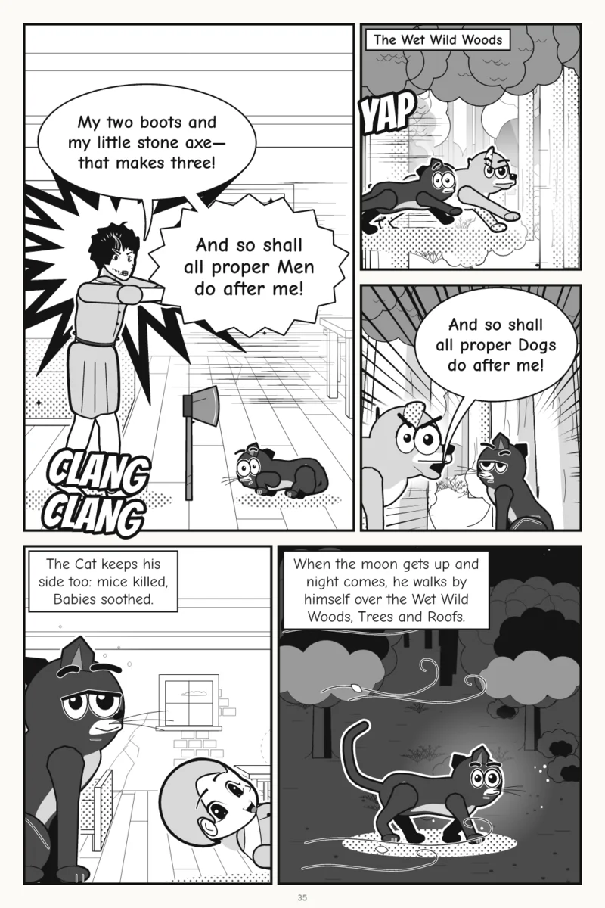 |

<sub>Real pages from real runs. Every page is drawn by code as SVG; no image model is used.</sub>

</div>

## Why PanelSummary

> I started building this for myself because I was tired of reading books, but somehow I never get tired of
> reading manga (lol).
>
> So I thought, why not turn books into manga?
>
> — **Mrigesh Thakur**, creator of PanelSummary

And that is what PanelSummary does. Give it a book PDF, and it turns the book into a manga-style experience that you
read right in your browser. It reads the whole book, plans how the book becomes pages, and writes each page as a
structured plan: panels, camera, characters and lettering. A deterministic renderer then draws every page as
ink-and-screentone SVG. Characters, places, props, effects, balloons and lettering are all code. Every page records
which parts of the book it adapts, and the reader can show them.

## Features

- **A whole book in one run.** Up to 75 PDF pages and 17,500 words per run. In the v0.3 runs a book took 8 to 14
  minutes, and the first page was ready after about 3 to 8 minutes.
- **Continue with the next section.** A longer book is drawn one part at a time. The next part keeps the same cast,
  looks and places, and the book page numbers the pages of all parts as one series.
- **Drawn by code, not by an image model.** The art is deterministic SVG: the same page plan always gives the same
  page. The only model is a text model (MiniMax), and it goes through one sealed worker.
- **Neutral stand-ins, not wrong guesses.** When a book needs an animal, a place or a prop that the renderer cannot
  draw, the page shows a neutral stand-in: an animal by its body plan, a generic place, or a prop by its shape, with a
  name tag. "About this adaptation" lists the stand-ins.
- **Faithful to the book.** Every lettered line is labelled quote, paraphrase, dramatized or metaphor. Every panel
  cites its PDF pages. The reader's Sources drawer shows them.
- **Honest about failure.** A page that cannot be drawn is shown as failed, with its reason. "Retry failed pages"
  redraws only those pages. Nothing accepted is paid for twice. If MiniMax stops a run (for example at a usage
  limit), the run card says so and "Resume drawing" continues it later.
- **A reader made for manga.** Page mode on a desktop, panel-by-panel mode on a phone, a page picker for long books,
  and a light and a dark theme.
- **Runs on your computer.** Your books and pages stay in a local database. Only the book text and page previews go
  to MiniMax, through the worker. The app makes no other third-party request and has no telemetry.
- **Low cost.** A whole book cost about $0.70 to $2.00 in the v0.3 runs (estimates at MiniMax-M3 rates, not a bill).
- **Measured, release by release.** [`docs/METRICS.md`](docs/METRICS.md) shows the quality, the time, the cost and the
  tokens of every release on the same books, with what got better and what got worse.

**Version 0.3** ([release notes](docs/launch/RELEASE-NOTES-v0.3.0.md)) added neutral stand-ins for books outside the
drawing vocabulary, a camera push that keeps every planned figure in the panel, "Continue with the next section",
writer and interface fixes, re-fitted estimates, and the evaluation tools. [`docs/v0.3/README.md`](docs/v0.3/README.md)
lists the v0.3 documents. **Version 0.2** ([release notes](docs/launch/RELEASE-NOTES-v0.2.0.md)) added the new app
interface, a choice of what part of the book to draw, an optional review of the plan before drawing, a built-in sample,
a larger reader page on desktop and a page picker.

## Examples

These are real pages from real runs: the first book is a v0.3 run, the others are v0.2 runs. Nothing is retouched:
each image is the SVG page that the app stored, drawn to an image. Each run drew the whole book in one go. Costs are
estimates at MiniMax-M3 rates, not a bill.

### *Thirteen Jataka Tales*, Ellen C. Babbitt (1912)

39 PDF pages → 28 manga pages, about $0.97. This book was sealed during the v0.3 build: the code was never tuned on it.
The MiniMax usage limit stopped the run at page 18, and one "Resume drawing" press finished it.

| "Why the Owl Is Not King of the Birds" | "The Foolish, Timid Rabbit" |
|---|---|
| 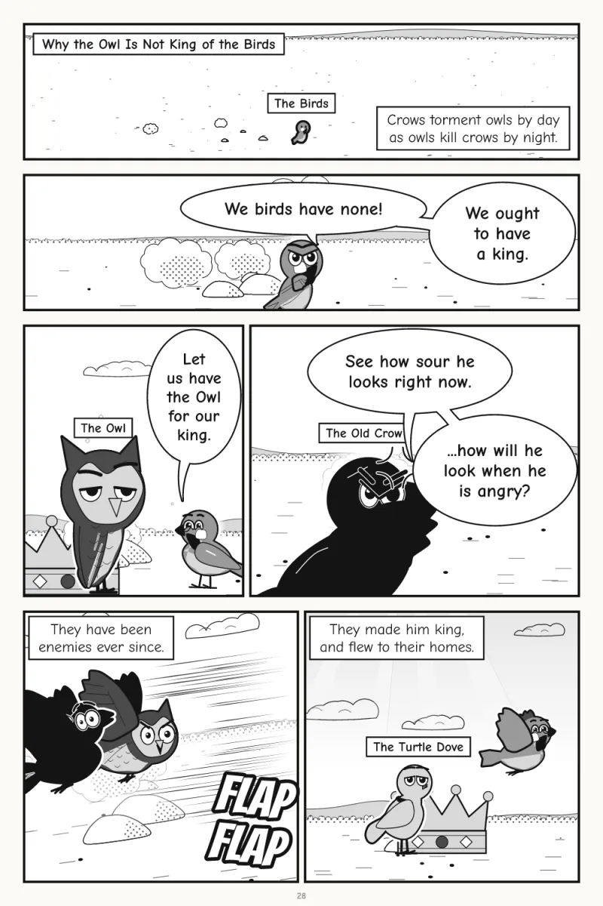 | 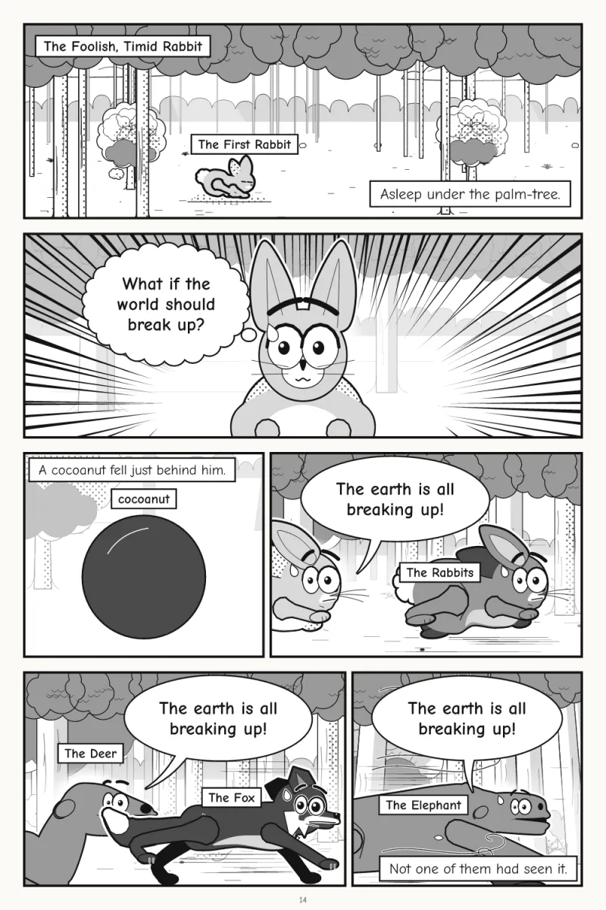 |

On the right, the deer and the elephant are neutral stand-ins with name tags, and the coconut is a neutral prop. They
are not wrong, but some are hard to read: the elephant has no trunk. That is [#121](https://github.com/Legend101Zz/PanelSummary/issues/121) for v0.4.

### *The Happy Prince and Other Tales*, Oscar Wilde (1888)

68 PDF pages → 60 of 61 manga pages in 14 min 42 s, about $1.88. One page failed and the app shows it as failed,
with its reason.

| "The Happy Prince" | "The Selfish Giant" |
|---|---|
|  | 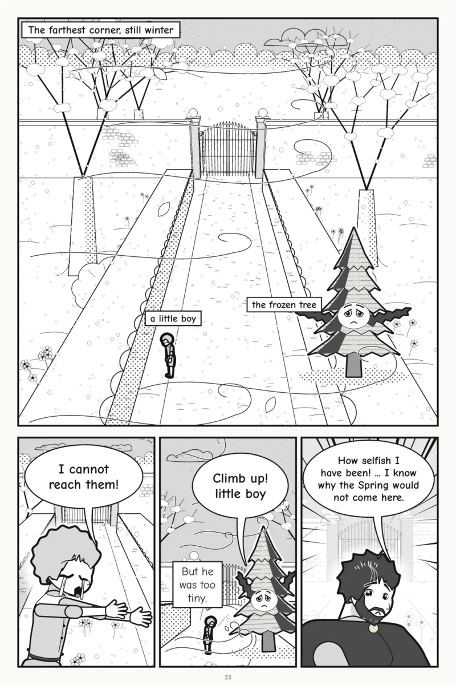 |

### *Three Just So Stories*, Rudyard Kipling (1902)

38 PDF pages → 35 manga pages in 7 min 44 s, about $0.99. This book was never used to tune the app.

| "The Cat that Walked by Himself" | "How the First Letter was Written" |
|---|---|
|  | 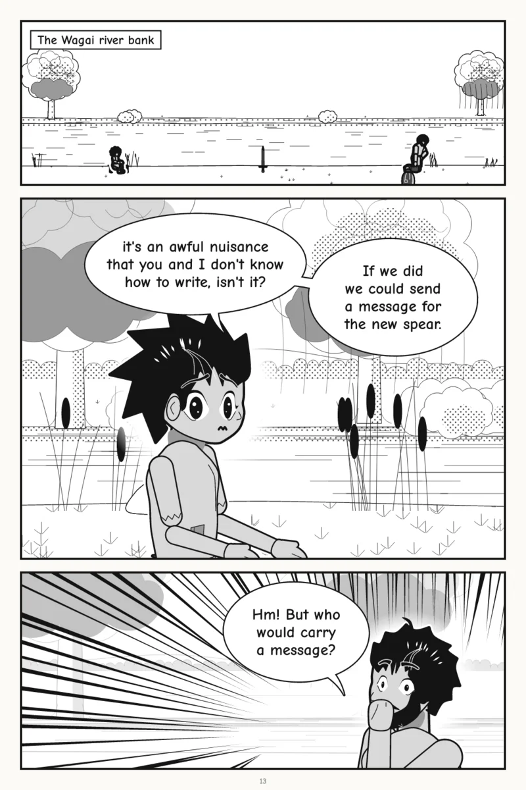 |

### *Self-Reliance*, Ralph Waldo Emerson (1841)

An essay with no story. 36 manga pages in 6 min 41 s, about $0.82. The app turns the argument into scenes
and gives some abstract ideas a drawn form.

| "A foolish consistency…" | "There is simply the rose" |
|---|---|
|  | 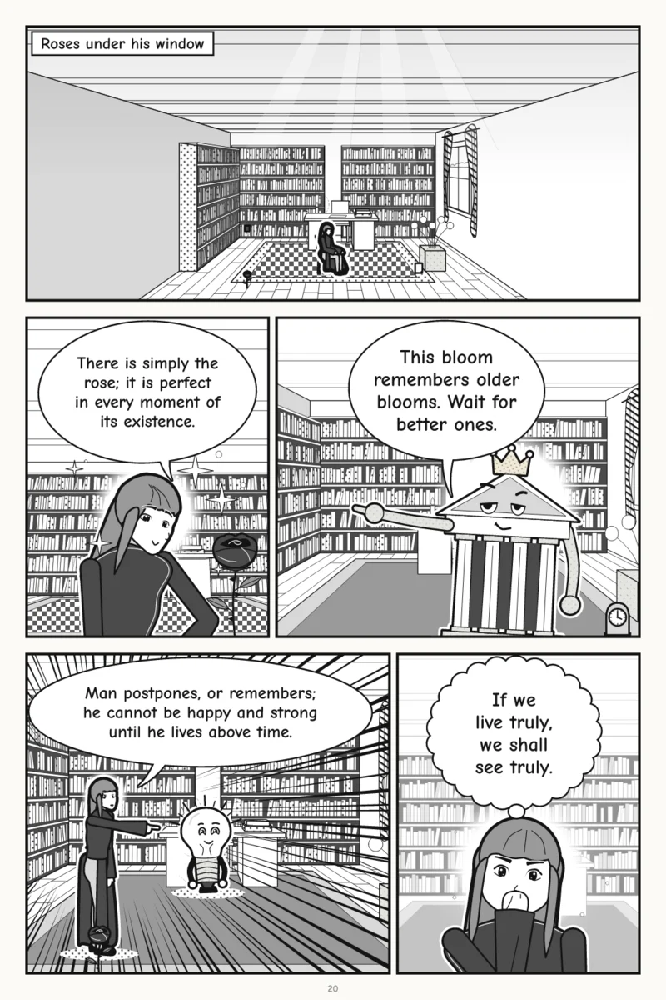 |

### *On the Duty of Civil Disobedience*, Henry David Thoreau (1849)

36 manga pages in 8 min 11 s, about $0.81.

| "The right is not won by counting heads" | "Serve it with your conscience" |
|---|---|
| 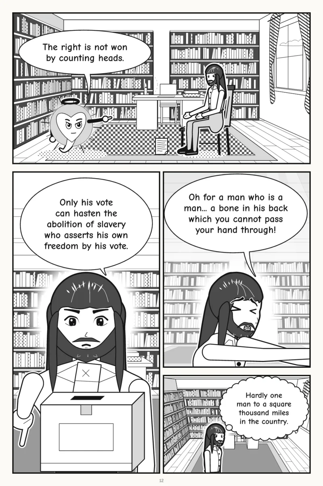 | 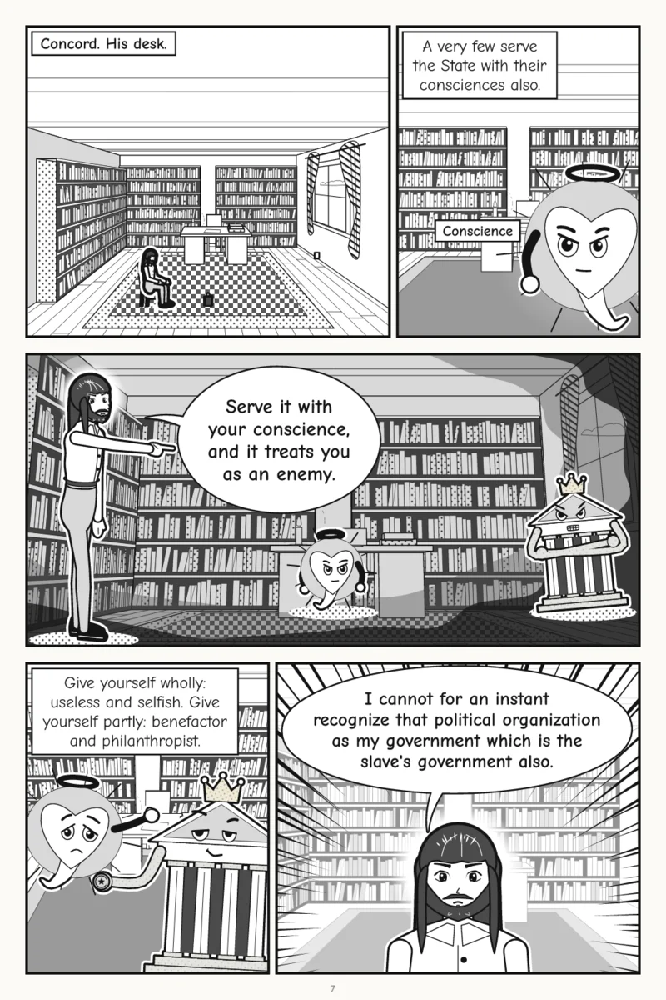 |

### *Who Moved My Cheese?*, Spencer Johnson (1998)

A modern business parable. 39 PDF pages → 44 manga pages in 9 min 9 s (page 1 after 3 min 34 s, as the book page
shows them), about $1.01.
The pages show 114 of the book's 129 key points; the plan left out 15 on purpose and says why.

| Hem: "I like it here. It's comfortable." | Haw, alone in the Maze |
|---|---|
| 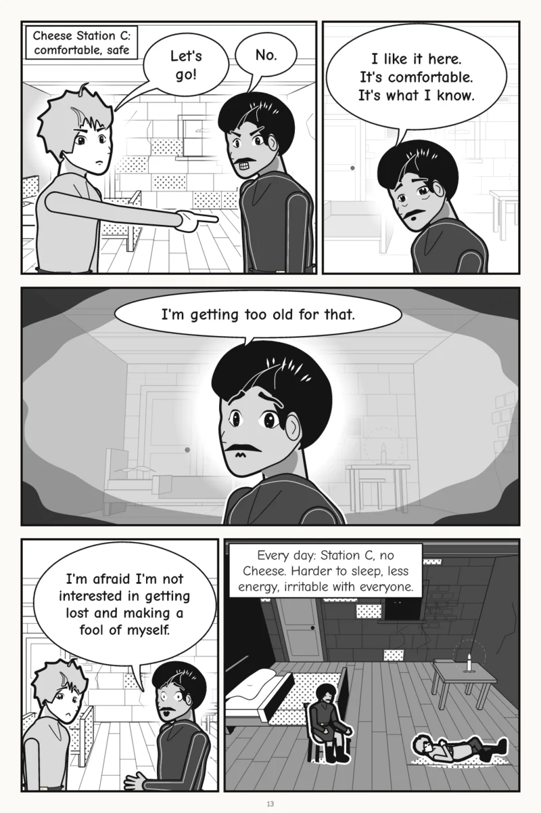 | 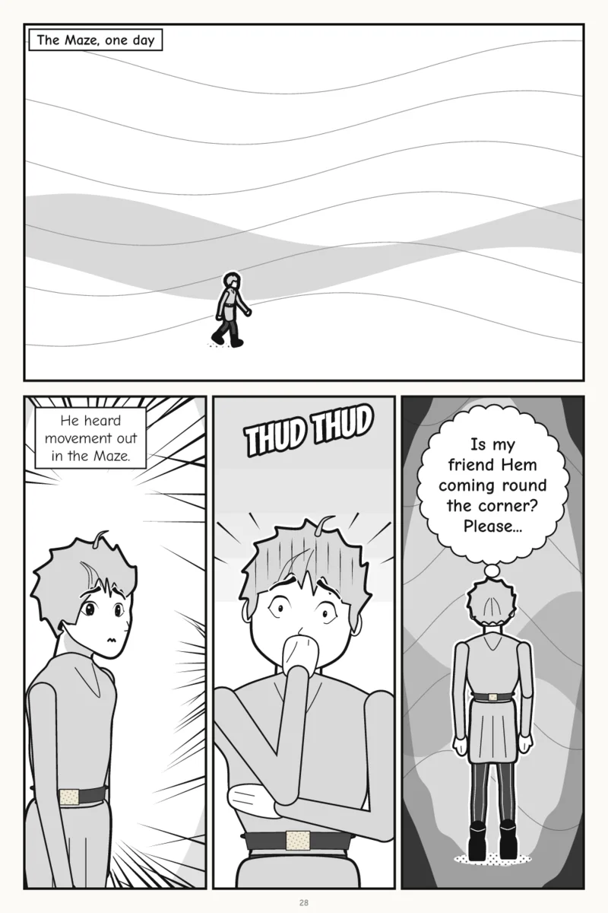 |

> *Who Moved My Cheese?* © 1998 Spencer Johnson. The book is under copyright. These two pages were made from the
> owner's own copy, only to show what the app does with a modern nonfiction book. They are not licensed for reuse.
> The other books on this page are in the public domain.

**What still goes wrong.** The drawing vocabulary is closed. In the v0.2 runs, when a book needed something that is
not in it, the app chose a confident wrong match: in *Just So Stories* a cave became a modern room, and in *Who Moved
My Cheese?* the cheese is a loaf of bread on several pages and the Maze is an empty plain. v0.3 draws a neutral
stand-in instead ([#81](https://github.com/Legend101Zz/PanelSummary/issues/81)). Three problems remain for v0.4: a key figure is often tiny or cropped
([#120](https://github.com/Legend101Zz/PanelSummary/issues/120)), many stand-ins are hard to read ([#121](https://github.com/Legend101Zz/PanelSummary/issues/121)), and places outside Europe are drawn
as European towns ([#122](https://github.com/Legend101Zz/PanelSummary/issues/122)).

## The app

| The first run | The shelf |
|---|---|
| 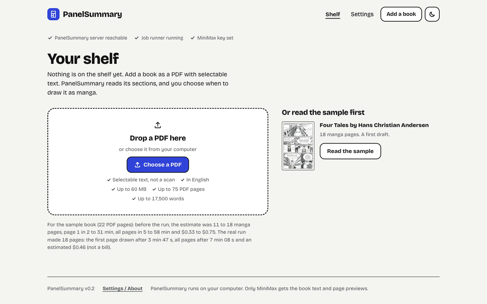 | 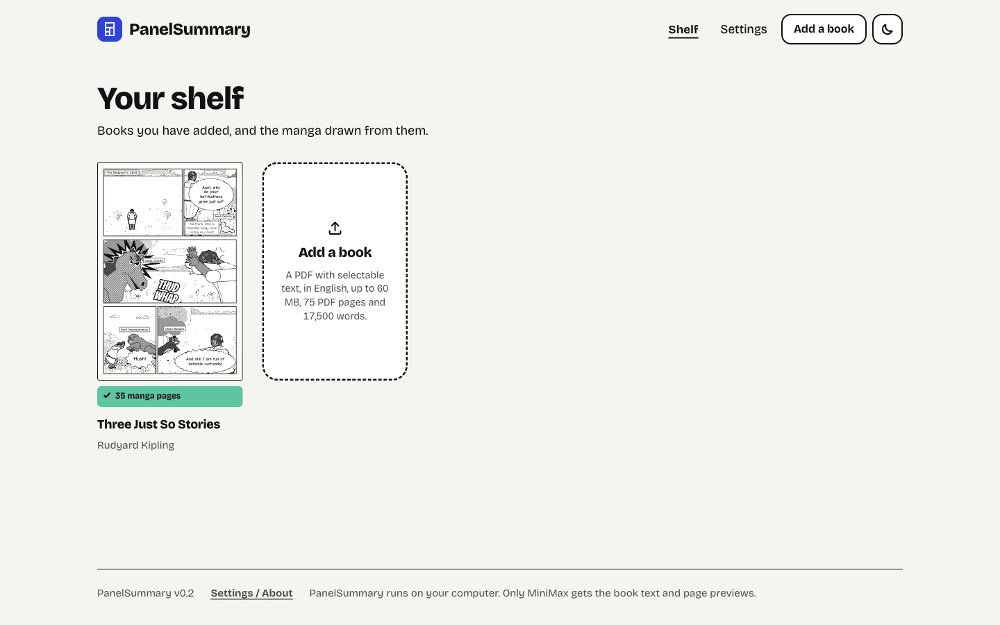 |

| Drawing | Finished (dark) |
|---|---|
| 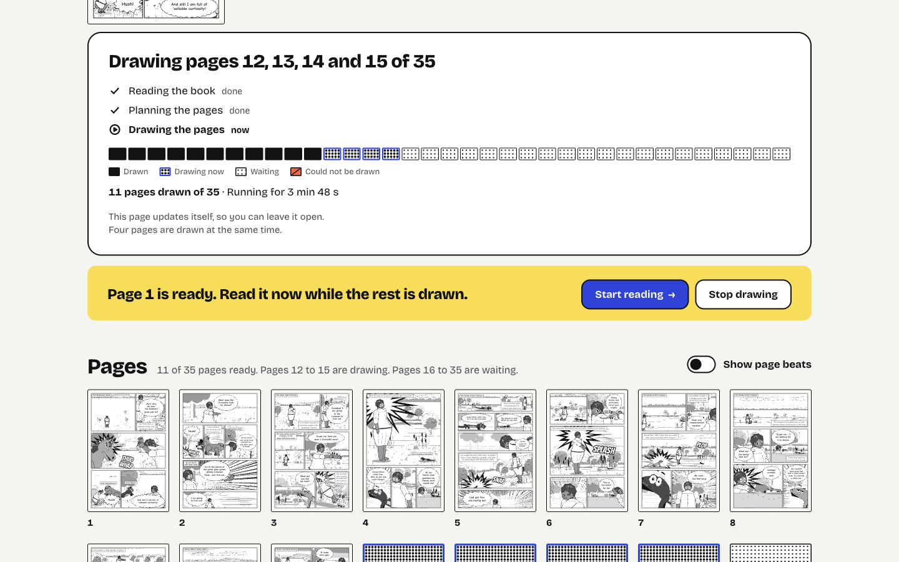 | 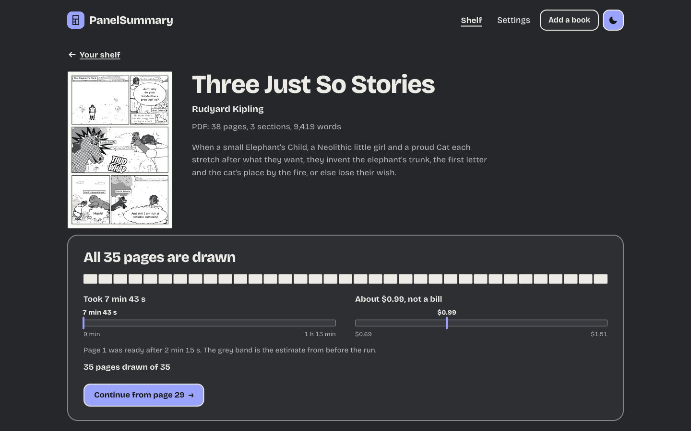 |

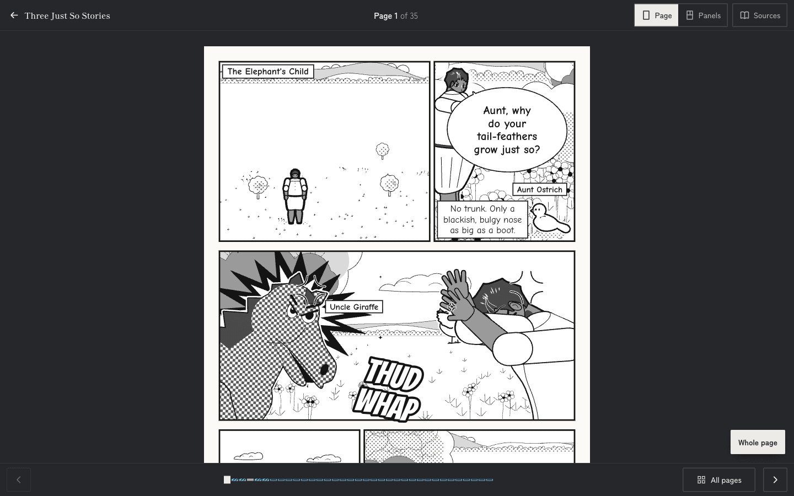

These screenshots are from a real v0.2 run of "Three Just So Stories" (35 pages), on a desktop
browser at 1440 pixels wide. The v0.3 screens are the same, with small changes (see the v0.3 release notes).
[Using PanelSummary](#using-panelsummary) describes each screen.

## How it works

```text
PDF ──► parse job ──────────► sections + page-true source units          backend (PyMuPDF)
          │
Generate ─┼─► BOOK_UNDERSTANDING  cast + looks, places, claims            ┐
          ├─► ADAPTATION_PLAN     pages, beats, claim → page ledger       │ MiniMax through the
          └─► MANGA_PAGE × N      one session per page, 4 in parallel:    │ sealed Pi harness
                                  preview (rendered PNG, vision) → submit ┘ (apps/agent-worker)
                                  submit = validate + render SVG           packages/manga-render
          ▼
MongoDB: edition, artifacts, pages (spec + SVG + panel geometry + receipts)
          ▼
Reader: shows the persisted SVG; panel mode moves the camera over the stored geometry
```

- **One path to the model.** Every MiniMax call goes through `apps/agent-worker`, which runs
  a sealed Pi session (`packages/agent-runtime`, Pi 0.80.10 pinned): no built-in tools, no
  ambient files, only the goal's domain tools, source text tagged as untrusted data, and
  limits on turns, tool calls, submissions, cost and time. The backend never holds the key.
- **Goals and tools.** Understanding and plan submit one JSON candidate each; a validator
  replies `ACCEPTED` or lists every error to fix. A page goal can `preview_page` (the
  renderer's issues plus the rendered PNG for M3 vision) before `submit_page`.
- **Visible failure.** A page that fails every attempt is stored as `failed` with its
  reason and shown as a failed page. An edition with failed pages ends
  `completed_with_failures`, and the coverage report lists the claims those pages carried.
  Resume redraws only failed or pending pages; nothing accepted is paid for twice.
- **Faithfulness.** Every lettered line is labelled `quote`, `paraphrase`, `dramatized` or
  `metaphor`, and every panel cites its source units and PDF pages. The reader's Sources
  drawer shows them.
- **Stand-ins.** The understanding says what the book wanted and what it could not map. A
  figure, place or prop that the renderer cannot draw becomes a neutral stand-in with a name
  tag (decisions D29 and D30).
- **Continue.** A new part reads the stored understanding of the earlier part as data and keeps
  its cast, looks and places (D38). The book page numbers the parts as one series (D39).

The generation policy (models per goal, thinking levels, retries) came from measured
experiments: [`docs/rebuild/EXPERIMENTS.md`](docs/rebuild/EXPERIMENTS.md). The current policy is
decision D13 in [`docs/decisions.md`](docs/decisions.md). That file also holds every other
decision and its reason. The launch notes are indexed in
[`docs/launch/README.md`](docs/launch/README.md). The v0.2 and v0.3 documents are indexed in
[`docs/v0.2/README.md`](docs/v0.2/README.md) and [`docs/v0.3/README.md`](docs/v0.3/README.md). The metrics
of every release are in [`docs/METRICS.md`](docs/METRICS.md).

## Quality

A panel of three AI judges (Claude Sonnet, the same prompt and rubric for every run) scores every page from 1 to 5
on eight criteria, such as legibility, fidelity to the book and continuity. A page passes the strict ship bar when no
criterion is below 3, legibility and fidelity are 4 or more, and the mean is 3.5 or more. A failed page counts as 0.
The judges are AI, not readers. Each book has one to three runs, and two runs of the same code can differ by up to
about 0.15. [`docs/METRICS.md`](docs/METRICS.md) compares every release on the same books;
[`docs/v0.3/GATES.md`](docs/v0.3/GATES.md) has the v0.3 gates.

| Book | v0.1.0 | v0.2.0 | v0.3.0 |
|---|---|---|---|
| *The Happy Prince and Other Tales*, 68 pages (used for tuning) | 12 of 60 at the strict bar, mean 3.54 | **20 of 61, mean 3.55** | 9 of 61, mean 3.54 |
| Two Wilde tales (used for tuning) | 2 and 4 of 22, means 3.42 and 3.49 | **6 of 22, mean 3.60** | 4 and 4 of 22, means 3.53 and 3.43 |
| *Just So Stories* (the v0.3 diagnosis book) | 4 of 30, mean 3.38 | 1–2 per run, means 3.40–3.44 (three runs) | 4 of 35, mean 3.46 |
| *Thirteen Jataka Tales* (sealed during v0.3) | — | 1 of 34 and 7 of 28, means 3.48 and 3.44 | **6 of 28 and 4 of 27, means 3.59 and 3.54** |
| *Indian Why Stories* (sealed during v0.3) | — | 6 of 41 and 5 of 36, means 3.44 and 3.44 | 1 of 41, mean 3.43 |
| *On a Piece of Chalk*, nonfiction (sealed during v0.3) | — | 6 of 33 and 2 of 28, means 3.49 and 3.35 | 3 of 31, mean 3.37 |
| *Self-Reliance* | — | 11 of 38 and 8 of 36, means 3.55 and 3.60 | not measured |
| *Civil Disobedience* | — | 11 of 36, mean 3.53 | not measured |
| *Who Moved My Cheese?* | — | 8 of 44, mean 3.56 | not measured |

**v0.3 on books that nobody tuned on.** On the two sealed fiction books, v0.3 left fewer key props undrawn (−24%) and
drew fewer wrong settings (−32%) than v0.2.0, and the mean went from 3.45 to 3.51. On the animal fables (*Jataka
Tales*) it is better in both runs. **The v0.3 bar was not met:** it asked for +0.08 and a quarter fewer tiny or cropped
key figures, and tiny or cropped figures did not go down. On the 68-page tuning book the mean holds, but fewer pages
pass the strict bar (9 against 20). Tiny or cropped figures are the first aim of v0.4.

v0.2 cut the defects that it aimed at on the 68-page book (blocker and major defects per judge-page): a hero drawn as
a speck or cut off 0.48 → 0.35, a balloon tail at the wrong figure 0.20 → 0.11, label clutter 0.16 → 0.08.

## Quick start

### Requirements

- macOS or Linux.
- Node 22.19 or newer, and pnpm 10.15.1 (`corepack enable` gives you the pinned pnpm).
- Python 3.12 and `uv`. Use 3.12 exactly. See step 2 below.
- `mongod` (for example `brew install mongodb-community`), unless you set
  `PANELSUMMARY_MONGODB_URL`.
- To draw your own books: a MiniMax API key (Anthropic-compatible endpoint). `start.sh` looks for
  it in this order: `$MINIMAX_API_KEY`, then `backend/.env` (`MINIMAX_API_KEY=`), then the macOS
  Keychain item `minimax_api_key`. It passes the key only to the agent worker and never prints it.
  `start.sh` stops with an error if it finds no key.
- No key is needed to read the built-in sample or to run the replay worker. See
  [Try it without a MiniMax key](#try-it-without-a-minimax-key).

### Install and run

```sh
git clone https://github.com/Legend101Zz/PanelSummary
cd PanelSummary
git checkout v0.3.0                                         # the v0.3 release; main has the same code

# 1. Install the workspace and the frontend (start.sh does this too if you skip it)
pnpm install --frozen-lockfile
(cd frontend && npm ci)

# 2. Make the backend environment with Python 3.12
(cd backend && uv venv -p 3.12 && uv pip install -r requirements.txt)

# 3. Start, verify, stop
./start.sh     # starts everything, prints the URL
./check.sh     # status of worker, API, runner, frontend
./stop.sh      # stops only what start.sh started
```

Step 2 is not optional. If `backend/.venv` does not exist, `start.sh` runs a plain `uv venv`.
`uv` then picks the newest Python on your machine. With Python 3.14 the install of
`pydantic-core` fails to build. If a failed `start.sh` left a `backend/.venv` behind, remove it
(`rm -rf backend/.venv`) and do step 2. A later `start.sh` would skip the install because the
directory exists.

After `start.sh` prints the URL, open it. On a new database the first run must show (a status line
and "Drop a PDF here"). After that the shelf page ("Your shelf") shows. Also run
`curl http://127.0.0.1:8000/health`. It must answer `{"status":"ok", ...}`. The API documents
are at `http://127.0.0.1:8000/docs`.

| Service | Where |
|---|---|
| Frontend (the app and the reader) | http://127.0.0.1:3100 |
| API | http://127.0.0.1:8000 (docs at `/docs`) |
| Agent worker (MiniMax harness) | 127.0.0.1:8788 (token-protected, loopback only) |
| Job runner | `python -m app.runner` (no port) |
| MongoDB | 127.0.0.1:27018, data in `.dev/mongo` |

### Change the ports

Another program can use these ports. Set these variables to move the stack. Use the same values
for `./check.sh`, because it reads the same variables. `./stop.sh` needs none: it stops the
processes by the pid files in `.dev/pids`.

```sh
export PANELSUMMARY_WEB_PORT=3240 PANELSUMMARY_API_PORT=8140 \
       PANELSUMMARY_WORKER_PORT=8804 PANELSUMMARY_MONGO_PORT=27036
./start.sh
```

You can also set `PANELSUMMARY_DB_NAME` to use a different database name. Open the app at
`http://127.0.0.1:` and the web port. Never use port 3000. `start.sh` refuses it as the web port.
Do not stop or probe the process on it.

### Database

The stack uses its own local MongoDB. To use another database, set `PANELSUMMARY_MONGODB_URL`
(and optionally `PANELSUMMARY_DB_NAME`) before `./start.sh`. Never use the Atlas URL that can
be in `backend/.env`. Logs are in `.dev/logs/`.

Generation policy lives in `backend/app/settings.py` (environment-overridable, for example
`PAGE_MODEL`, `PAGE_THINKING`, `PAGE_VISION`, `PAGE_CONCURRENCY`, `PLAN_REVIEW_DEFAULT`) and is
recorded on every edition. See D13 in `docs/decisions.md` for the current values and the reasons.

### Try it without a MiniMax key

The replay worker answers like the real worker, but it plays back a saved run. The whole journey
(upload, parse, Generate, the run card, the reader) runs through the real backend and the real
screens. No model is called and nothing is spent. `start.sh` does not look for a key.

```sh
PANELSUMMARY_REPLAY_WORKER=scripts/fixtures/replays/happy-prince-two-tales ./start.sh
./check.sh      # says that the worker is the REPLAY worker
```

Then open the app, choose **Add a book** and upload the PDF that matches the package:
`scripts/acceptance/books/happy-prince-two-tales.pdf`. Press **Generate manga**. The run ends in
about one minute (48 seconds in the last check) with 22 pages. Use another PDF and the run fails with `REPLAY_BOOK_MISMATCH`.
The package `scripts/fixtures/replays/andersen-18` replays the Andersen run, but its PDF is not in
the repository. The built-in sample needs no replay: it is stored data.

A replay shows today's checks and today's renderer on a saved run. It says nothing about model
quality, speed or cost. Every receipt says provider `replay`. Options (delays, failing pages, a
MiniMax stop) are in [`docs/v0.2/F1-replay-worker.md`](docs/v0.2/F1-replay-worker.md). Stop the stack
with `./stop.sh`.

In replay mode the first-run status line and Settings say "Replay worker: no MiniMax key is used; pages come from a saved run." instead of "MiniMax key set".

## Using PanelSummary

1. **First run.** On an empty shelf the app shows three facts in one line: the server is reachable,
   the job runner runs, and the MiniMax key is set or not set. Below are a drop zone with every
   limit and, on the right, "Or read the sample first". If the server or the key is missing, the
   screen says what to do.
2. **Add a book.** Drop a born-digital PDF (selectable text, in English) or press "Choose a PDF".
   The limits are 60 MB, 75 PDF pages and 17,500 words for one run. Parsing takes seconds. The
   screen says what it read ("Read 22 PDF pages and found 4 sections.") and moves to the book page.
   A scan with no text layer is refused with the next step. A book that is already on the shelf is
   not added twice.
3. **The estimate.** The book page shows the size of the book, the limits, and a low and a high
   estimate of pages, cost and time. The estimate is a range from measured runs. It is not a quote.
   If the book is over a limit, you must choose a smaller part first (step 6).
4. **Generate manga.** One button starts the run. The run card names the stage (reading the book,
   planning the pages, drawing pages 12 to 15 of 35), the running time and a **tone strip**: one
   cell for each page. A cell is drawn, drawing now, waiting, or could not be drawn. The page
   updates itself, so you can leave it open. Four pages are drawn at the same time.
5. **The page 1 moment.** When page 1 is drawn, a yellow band says "Page 1 is ready. Read it now
   while the rest is drawn." with "Start reading" and "Stop drawing". Page 1 comes after the whole
   book is read and planned. In the runs shown here that took 2 to 4 minutes. A whole run took about 7 to 8 minutes. Earlier
   v0.1 runs took up to 30 minutes, depending on MiniMax output speed at the time.
6. **Choose what to draw.** "Draw only part of the book" opens a control. Choose one or more
   sections, or a range of PDF pages. The estimate and the limits follow your choice. A book over
   the limits can be drawn in parts. When a part is drawn, "Continue with the next section" draws
   the next sections as a new part with the same cast, looks and places. "Parts of the book" on the
   book page numbers the pages of all parts as one series; the reader numbers each part from 1.
7. **Review the plan (optional).** Turn on "Review the plan before drawing" in Settings. Generate
   then reads the book and makes the plan, and stops. The screen shows the page count, a cost
   range for drawing, the cast, one line for each page and the key points that the plan leaves
   out. Press "Draw the pages" to go on, or "Stop". The choice is off by default.
8. **Stop, resume, retry.** "Stop drawing" ends a run. "Resume drawing" continues it and redraws
   only the pages that are not accepted. "Retry failed pages" redraws only the failed pages.
   "Draw this page again" redraws one page. Nothing accepted is paid for twice.
9. **MiniMax stops.** If MiniMax refuses a call (a usage limit, a key that it refuses, or no
   answer), the run stops and the card says which. Fix the cause, then press "Resume drawing".
10. **Read.** "Start reading" opens the reader. Page mode on wide screens, panel mode (the camera
    steps panel by panel) on phones. On a desktop the page is shown at a larger "read size" so that
    captions are readable (about 15 px). It needs scrolling. "Whole page" shows the full page, as in
    v0.1. "All pages" opens a picker with a button for each page, in groups by section. Arrow keys,
    Space, swipe, tap zones, zoom and reduced motion work. The page number is in the URL.
11. **Sources.** The Sources drawer lists what the page conveys, each panel's PDF pages (links to
    the source viewer), and every line with its fidelity label.
12. **Settings.** Choose a light, dark or system theme. Settings also shows the server status, the
    models, the limits, what leaves the computer, and the plan review switch.
13. **The sample.** "Read the sample" on the first run installs the built-in edition "Four Tales by
    Hans Christian Andersen" (18 pages, public-domain text). It makes no model call. It is a real
    v0.1 run, so it shows the run's real cost and time, and it is a first draft.

### What a failed page looks like

A page that fails every attempt is never hidden. On the book page it shows in the list of failed
pages with a plain reason and the technical detail. The shelf card and the progress text show a
red "N of M drawn, K missing" and the edition ends `completed_with_failures`. In the reader, the
page shows "This page could not be drawn", the reason, the number of failed pages, a "Retry
failed pages" button and a link back to the book. Retry redraws only the failed pages.

## Development

### Verify

No model calls, no spend. The backend tests need a MongoDB. They use
`$TEST_MONGODB_URL` (default `mongodb://127.0.0.1:27018`) and create their own databases. If you
moved the ports, point the tests at the MongoDB of your stack, for example
`export TEST_MONGODB_URL=mongodb://127.0.0.1:$PANELSUMMARY_MONGO_PORT`. Run the commands from the
repository root.

```sh
(cd backend && .venv/bin/python -m pytest tests -q)        # parser, static guards, offline journey, preflight, samples
(cd apps/agent-worker && npx tsc --noEmit && npx vitest run)   # includes the replay worker
(cd packages/agent-runtime && npx tsc --noEmit && npx vitest run)
(cd packages/manga-render && npx tsc --noEmit && npx vitest run)
(cd frontend && npx tsc --noEmit && npm test)
python3 -m unittest discover -s scripts/acceptance/judge    # the judge tools (no model call)
./stop.sh                                                  # the build below must not run while the stack runs
(cd frontend && npm run build)
```

`start.sh` runs `next dev` in `frontend/`. A production build in the same folder breaks it, so run
`npm run build` only after `./stop.sh`. The backend tests need the MongoDB, so run them before
`./stop.sh` (or start your own `mongod`).

GitHub Actions runs the same checks on every pull request into `release/v0.1`, `release/v0.2`, `release/v0.3` and
`main`. It
also has a manual lane for a live run with real MiniMax calls. See
[`docs/launch/CI.md`](docs/launch/CI.md).

- `backend/tests/test_generate_journey.py` drives upload → parse → Generate → page API against
  a fake worker and fails if Generate bypasses the worker, if the page API serves anything but
  the worker's exact SVG and geometry, if a failed page's claims vanish from coverage, if resume
  repeats accepted work, or if the backend contacts any other host.
- `backend/tests/test_static_guards.py` fails if an image-generation surface or a direct LLM SDK
  appears in the backend.
- `backend/tests/test_samples.py` verifies the built-in sample: install, idempotence and the API.
- `backend/tests/test_preflight.py` verifies the size limits and the preflight estimates
  against the measured runs.
- A live acceptance check against a running stack (real MiniMax calls) is described in
  [`docs/rebuild/ACCEPTANCE.md`](docs/rebuild/ACCEPTANCE.md). The quality judge harness is in
  [`docs/launch/EVAL.md`](docs/launch/EVAL.md).
- `scripts/acceptance/judge/` holds the judge tools and a fixture of every judged gate run.
  [`docs/METRICS.md`](docs/METRICS.md) says how to recompute the metrics of every release.


### Repository layout

```text
backend/            FastAPI API, job runner, PDF parser (Python); backend/samples/ holds the built-in sample
apps/agent-worker/  MiniMax goals, skills, local tools, the replay worker, experiment CLI (TypeScript)
packages/agent-runtime/  sealed Pi session runtime (the only Pi import)
packages/manga-render/   deterministic renderer: contracts, validators, layout, rigs,
                         environments, props, fx, lettering, SVG, PNG preview
frontend/           Next.js: app screens in app/(app), reader and PDF viewer in app/(reader),
                    shared components in components/ui
scripts/acceptance/ live journey, run export, test books and the quality judge harness
scripts/fixtures/   state seeder (seed_states.py) and the saved runs for the replay worker
.github/workflows/  CI (ci.yml) and the manual live lane (live-journey.yml)
docs/               decisions.md, METRICS.md (every release), design/ (v0.2 design), v0.2/ and v0.3/ (track notes),
                    launch/ (release notes), rebuild/ (evidence), images/v0.2/ (README screenshots),
                    images/examples/ (README example pages)
```

## Limits

The limits that the tracks measured are listed here. The detail is in
[`docs/launch/`](docs/launch/README.md), [`docs/v0.2/`](docs/v0.2/README.md) and [`docs/v0.3/`](docs/v0.3/README.md).

- **Book size.** A run draws up to 75 PDF pages and 17,500 words (decision D19). The limit
  applies to the part you choose. A longer book can be drawn in parts: choose sections or a range
  of PDF pages for each run. The largest book that finished end to end in the launch runs has 68
  PDF pages and 16,159 words. `POST /books/{id}/editions` refuses a larger run with HTTP 422 and a
  plain reason. It starts no job and spends nothing. Upload accepts any PDF that parses, up to 60
  MB. The limits are configuration (`MAX_PDF_PAGES`, `MAX_SOURCE_WORDS`). A slow MiniMax hour can
  still time out the understanding of a book that is inside the limits. The edition then fails
  with a visible reason.
- **Estimates are ranges.** Time and cost estimates come from measured runs. MiniMax output speed
  varied from 31 to 324 tokens per second across the runs. An estimate is not a bill.
- Born-digital PDFs only (no OCR).
- The drawn vocabulary is closed: characters, places, props and effects must map to what the
  renderer can draw. The model is told the vocabulary and validation rejects anything else. What
  it cannot draw becomes a neutral stand-in with a name tag. Stand-ins are often hard to read
  ([#121](https://github.com/Legend101Zz/PanelSummary/issues/121)), and places outside Europe are drawn as European towns ([#122](https://github.com/Legend101Zz/PanelSummary/issues/122)).
- English, left-to-right pages by default (the layout compiler also supports right-to-left).
- "Continue with the next section" makes a new edition for each part. A part cannot repeat text
  that an earlier part drew. The reader numbers each part from 1 ([#128](https://github.com/Legend101Zz/PanelSummary/issues/128)); the book
  page shows the series numbers.
- **Page quality is uneven.** In the acceptance runs a panel of judge agents rated a minority of
  pages at the strict ship bar. The largest fault on every book is a key figure that is tiny or
  cropped ([#120](https://github.com/Legend101Zz/PanelSummary/issues/120)). Other faults are claims only partly shown, a character's state
  across pages, and props that the closed vocabulary draws loosely. See
  [`docs/rebuild/ACCEPTANCE.md`](docs/rebuild/ACCEPTANCE.md) and the track notes in `docs/launch/`
  `docs/v0.2/` and `docs/v0.3/`. The built-in sample is a v0.1 run, not a v0.3 run.
- **What leaves the computer.** Only the book text and page previews go to MiniMax, through the
  worker. The app makes no other third-party request: the fonts are in the repository and
  Next.js telemetry is off.

## Roadmap

v0.4 has one goal: **make the figures and the stand-ins readable on books that nobody tuned on**, measured on new
sealed books against v0.3.0 with the same judge panel, with no more tokens per page than v0.3. The first issues:

- [#120](https://github.com/Legend101Zz/PanelSummary/issues/120): a key figure is often tiny or cropped (the largest judged defect on every book).
- [#121](https://github.com/Legend101Zz/PanelSummary/issues/121): stand-ins that are easier to read (an animal, a prop).
- [#122](https://github.com/Legend101Zz/PanelSummary/issues/122): places outside Europe and before modern times.
- [#124](https://github.com/Legend101Zz/PanelSummary/issues/124): tokens per page and the MiniMax plan limit.
- [#130](https://github.com/Legend101Zz/PanelSummary/issues/130): a new set of sealed books.

All open v0.4 work has the label [`v0.4`](https://github.com/Legend101Zz/PanelSummary/issues?q=is%3Aissue+is%3Aopen+label%3Av0.4).

## Contributing

Bug reports, ideas and pull requests are welcome. Open an
[issue](https://github.com/Legend101Zz/PanelSummary/issues) first for a large change. Run the checks in
[Verify](#verify) before you send a pull request. Read the [License](#license) before you use the code.

## License

Copyright © 2026 **Mrigesh Thakur** ([@Legend101Zz](https://github.com/Legend101Zz)). All rights not granted by the
license are reserved.

PanelSummary is **source-available** under the [PolyForm Noncommercial License 1.0.0](LICENSE.md).

- **You may** read, run, change and share the code for any **noncommercial** purpose. Examples: personal use,
  study, research, hobby projects, and use by a charity, a school, a public research body or a government body.
- **You may not** use it for a commercial purpose without written permission from the owner. Examples: sell the
  software or a changed copy, sell a hosted service or a product built on it, or use it to earn money in a business.
- **A commercial license** is possible. Contact Mrigesh Thakur through [GitHub](https://github.com/Legend101Zz).
- When you share the code, include [`LICENSE.md`](LICENSE.md) and its `Required Notice:` line.

This is not an OSI-approved open-source license, because it does not allow commercial use.

Some parts have their own licenses, and those licenses apply to them:

- The fonts: SIL Open Font License 1.1. The license text is next to each font family, in an `OFL-*.txt` file:
  Bricolage Grotesque, Bangers and Comic Neue in `frontend/public/fonts/`; Shippori Mincho B1 and Zen Kaku Gothic New
  in `frontend/public/fonts/ui/`; Bangers and Comic Neue in `packages/manga-render/fonts/`.
- `.claude/skills/simple-english/`: MIT License (its own `LICENSE` file).
- The books in `scripts/acceptance/books/` are public-domain texts from Project Gutenberg.
- The two *Who Moved My Cheese?* example pages are © 1998 Spencer Johnson (see the note in [Examples](#examples)).

---

<div align="center">
<sub>Made by <a href="https://github.com/Legend101Zz">Mrigesh Thakur</a>, for people who would rather read manga.</sub>
</div>
